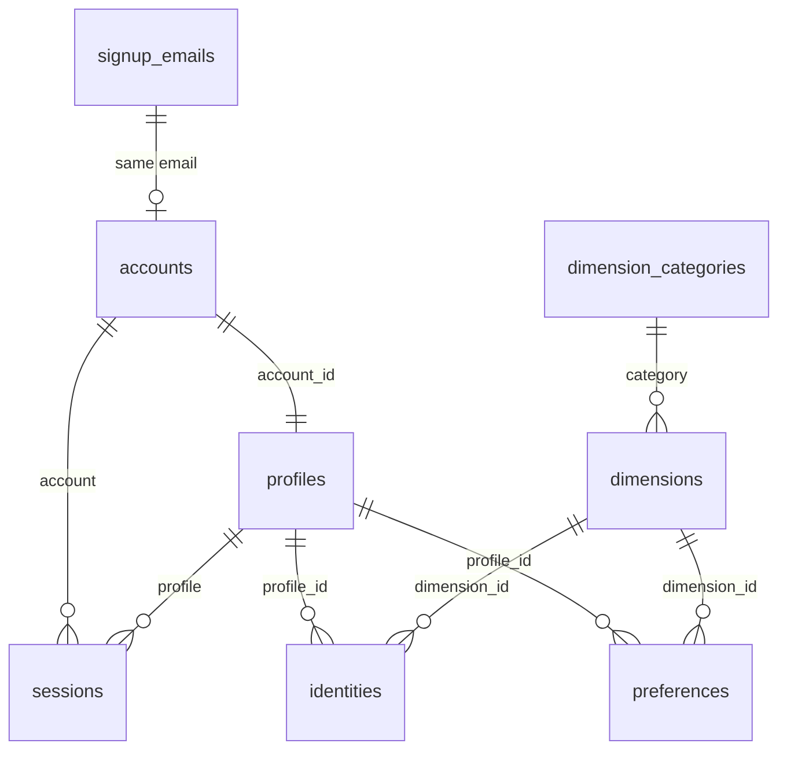

# Data model

The schema is in `sql/*.sql`, the seed data in `sql/data/`, and later changes in `sql/migrations/`. All tables are InnoDB. The database has **no foreign keys**, so the relationships below exist only in the PHP code.

## Tables

### `signup_emails`
The waiting list, and the source of invite codes. Character set `latin1`, unlike the other tables.

| Column | Type | Notes |
|---|---|---|
| `id` | int, auto increment | |
| `email` | varchar(100) | Lowercased by the code. Not unique |
| `signup_time` | timestamp | Defaults to now |
| `invited_time` | timestamp, null | Set when an invite email is sent |
| `invite_code` | varchar(100), null | `*` + an MD5; see [invites](README.md#signing-up-and-invites) |

### `accounts`
| Column | Type | Notes |
|---|---|---|
| `id` | int, auto increment | |
| `email` | varchar(1000) | Lowercased by the code. Not unique |
| `creation_time` | timestamp | Defaults to now |
| `signupEmail_id` | int, null | Meant to point at `signup_emails.id`, but always NULL (see [the model layer](#how-the-php-models-read-and-write)) |
| `password_hash` | varchar(1000) | The MD5 the browser sends; see [sessions](README.md#requests-responses-and-sessions) |

### `profiles`
One per account, created with it.

| Column | Type | Notes |
|---|---|---|
| `id` | int, auto increment | |
| `account_id` | int | `accounts.id` |
| `preferred_name` | varchar(200), null | Starts as the part of the email before `@` |
| `birthday` | date, null | Shown to others as an age, but sent in full |
| `picture_file` | varchar(256), null | File name in `pictures/`; NULL shows `vitruvian-man.jpg` |
| `nyc` | tinyint, null | 1 = New York City area, 0 = outside it, NULL = not answered. Used to filter matches |
| `contact` | varchar(500), null | Free text the user wants matches to contact them by |
| `bioline` | varchar(140) | Defaults to `Human` |
| `bio1`, `bio2`, `bio3` | varchar(5000), null | Free-text bios |
| `identity_norm`, `preference_norm` | double | Vector lengths for matching, kept up to date by the API (#20); see [Matching](matching.md) |

### `sessions`
| Column | Type | Notes |
|---|---|---|
| `id` | int, auto increment | Sent by the browser as `session_info.id` |
| `account`, `profile` | int | `accounts.id`, `profiles.id` |
| `signon_time` | timestamp | Defaults to now |
| `last_action_time` | timestamp | Never updated |
| `ip_address` | varchar(255) | Requests must come from this IP |
| `session_hash` | varchar(100) | Sent by the browser as `session_info.hash` |
| `active` | tinyint | 1 = valid. Nothing in the app ever sets it to 0 |

### `dimension_categories` and `dimensions`
The questions everyone answers about themselves and about who they're looking for. Seeded from `sql/data/`; nothing in the app changes them.

| Table | Columns |
|---|---|
| `dimension_categories` | `id`, `name`, `color` (a CSS colour), `default_order` |
| `dimensions` | `id`, `name`, `category` (`dimension_categories.id`), `default_order` (order within the category) |

The seed data has 284 dimensions, with ids 1–286 (129 and 239 are unused), in 8 categories:

| Category | Dimensions | Category | Dimensions |
|---|---|---|---|
| Gender | 21 | Interests | 29 |
| Relationship Style | 25 | Values | 31 |
| Sexuality | 71 | Personality | 27 |
| Life | 44 | Body | 36 |

### `identities` and `preferences`
These two tables have the same shape. An identity is "this describes me"; a preference is "I'm looking for this".

| Column | Type | Notes |
|---|---|---|
| `id` | int, auto increment | |
| `profile_id`, `dimension_id` | int | Unique together (#20) |
| `yesNo` | tinyint | 1 = yes, -1 = no, 0 = not answered. Clicking the selected button again resets it to 0 |
| `slider` | float | How strongly: 0 to 10 in steps of 0.1, default 1. Stored at single precision, so SQL calculations see 0.7 as 0.699999988 |
| `updated` | timestamp | Meant to change on every save, but never does (see below) |

Every profile gets a row for every dimension, 284 in each table, the first time its identities or preferences are loaded, so most rows are unanswered. Answers are only read as `yesNo × slider`, a value from -10 to 10.

Indexes (#20):
- `profile_dimension` (unique);
- `dimension_answer` (`dimension_id`, `yesNo`, `profile_id`, `slider`), used for scoring;
- `answered` (`yesNo`, `profile_id`, `slider`, `dimension_id`), used for the top-3 lists.

## Migrations

There's no migration tool; files in `sql/migrations/` are run by hand in phpMyAdmin, in order. The `sql/*.sql` files are kept up to date, so a fresh install needs only those plus the seed data.

| File | What it does |
|---|---|
| `001_sql_matching.sql` (#20) | Removes duplicate identity/preference rows, adds the indexes above, and adds and fills `identity_norm`/`preference_norm` |

## How the PHP models read and write

Each table has a model class (`Account`, `Profile`, `Session`, `SignupEmail`, `Dimension`, `DimensionCategory`, `Identity`, `Preference`) built on `DBObject.php`. All SQL is built as strings in `DBConnectionFactory.php`, with values escaped and quoted. `Matcher.php` writes its own SQL.

- **Each model lists its columns.** Values for unlisted columns are dropped when a row is loaded, and `setValue()` silently ignores unlisted names. That's why `signupEmail_id` is never saved: `Account` lists it with the column name `SignupEmail_id`, but `Api.php` sets `signupEmail_id`.
- **`getValues(true)` expands linked records.** For each linked column it adds a `<column>_values` entry, recursively. That's how identity rows in API responses come to include the whole profile and account, password hash included.
- **Inserts skip any value that's `0`, `'0'`, `''` or NULL**, so the column default is used instead. After an insert the row is read back, unless the caller opts out.
- **Updates write every non-NULL column**, so a column can never be set back to NULL. Writing back the old `updated` value also stops `ON UPDATE CURRENT_TIMESTAMP` from ever applying.
- **Lookups only work on one column.** Several conditions are joined without `AND`, which is invalid SQL. Nothing currently does this.
- **No transactions.** Since PHP 8.1, mysqli throws an exception on any SQL error, so a failed query ends the request with a 500, and the code's own error logging never runs.
